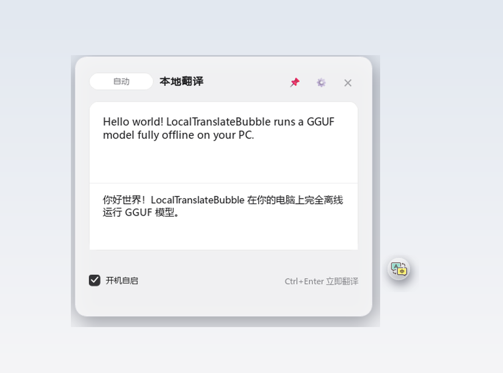
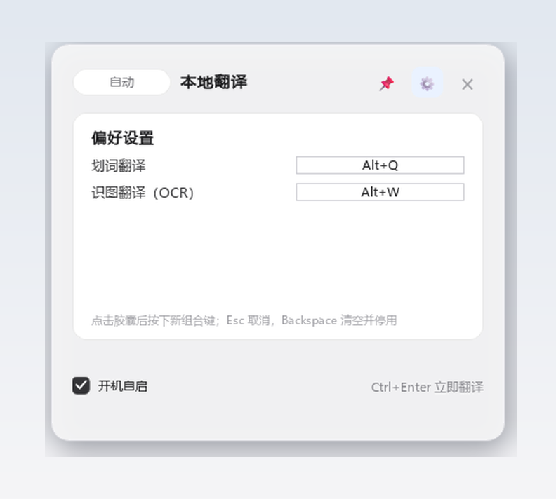

<div align="center">


# 本地翻译悬浮球 (translation_bubble)

**Windows 本地离线翻译悬浮球：双语对话气泡 + macOS 浅色翻译面板 + GGUF 本地大模型**

[](https://github.com/Shewishees/translation_bubble/actions/workflows/build.yml)
[](LICENSE)
[]()
[](https://github.com/ifocus9/PopTrans)

[简体中文](README.md) · [English](README_EN.md)

*划词翻译 · 截图 OCR · 流式输出 · GPU 自动加速 · 全程离线*



</div>

---

**LocalTranslateBubble** 是一款 Windows 本地离线翻译工具：双语对话气泡常驻桌面呼吸浮动，
划词或截图后一键翻译，译文在 macOS 风格浅色面板中**逐字流式输出**。
推理能力整合自 [PopTrans](https://github.com/ifocus9/PopTrans) 的 Python AI 引擎：
`llama.cpp` 在本地运行腾讯 **Hy-MT2-1.8B** GGUF 模型，**RapidOCR** 提供截图文字识别，
全程离线、文本不出本机。

## ✨ 核心特性

- **🌀 悬浮气泡常驻**：气泡以 120FPS 亚像素动画呼吸浮动；划词/截图后平滑飞至光标附近，点击即展开面板。
- **✍️ 划词快捷翻译**（默认 `Alt+Q`）：任意应用选中文本后按快捷键，自动模拟 `Ctrl+C` 取词（备份并还原剪贴板），面板与气泡平滑移动到光标附近并立即流式翻译。
- **📷 截图 OCR 翻译**（默认 `Alt+W`）：全屏框选（圆角高亮选区）→ RapidOCR 识别 → 立即翻译。
- **🖱️ 点击外部自动收起**：面板失焦即平滑收起且**保留翻译历史**；标题栏 📌 图钉可钉住面板暂停自动收起；气泡点击带 200ms 防抖，杜绝"关了又开"闪烁。
- **⌨️ 快捷键可视化录制**：面板标题栏 ⚙ 打开偏好设置视图，点击胶囊按下新组合即可换键（Esc 取消、Backspace 停用），即时生效并检测冲突（浅红提示）。
- **⚡ 流式输出**：OpenAI 兼容 `/v1/chat/completions`（SSE），译文逐字呈现；LRU 缓存 256 条，重复文本秒回。
- **🎮 GPU 自动加速与安全降级**：`acceleration_device = auto/gpu/cpu`，优先 CUDA/Vulkan 全量卸载（实测 RTX 5070 提速 3~5 倍），失败自动回退 CPU。
- **🛌 AI 空闲回收**：15 分钟无请求自动休眠释放显存，下次翻译毫秒级自动唤醒。
- **⚙️ settings.json 热加载**：与 PopTrans 字段规范完全一致，保存即生效，无需重启。

## 🚀 快速开始

1. 从 [Releases](https://github.com/Shewishees/translation_bubble/releases) 下载 `LocalTranslateBubble-vX.Y.Z-windows-x64.zip` 并解压；
2. 双击 `LocalTranslateBubble.exe`——首次运行自动下载翻译模型（约 1.1GB，支持断点续传；也可手动放入 `models/Hy-MT2-1.8B-GGUF/`）；
3. 模型就绪后面板显示 **GPU 加速已就绪 / CPU 模式已就绪**，开始翻译。

> 💡 系统要求：Windows 10/11 x64；CPU 模式建议 8GB 内存；GPU 模式显存 ≥ 2GB。

## ⌨️ 快捷操作

| 操作 | 快捷方式 | 说明 |
| --- | --- | --- |
| 打开翻译面板 | 点击气泡 | 气泡自动停靠面板右侧 16px |
| 划词翻译 | `Alt+Q` | 面板与气泡飞至光标附近，自动填入并流式翻译 |
| 截图 OCR 翻译 | `Alt+W` | 全屏圆角框选，Esc 取消 |
| 钉住面板 | 标题栏 📌 | 点亮后点击外部空白不自动收起 |
| 偏好设置 | 标题栏 ⚙ / 右键气泡 | 录制自定义全局快捷键 |

<p align="center"></p>
| 立即翻译 | `Ctrl+Enter` | 面板内跳过 600ms 防抖 |
| 切换方向 | 标题旁药丸 | 自动（中英互译）→ 中→英 → 英→中 |
| 退出 | 右键气泡 | 打开面板 / 划词 / 截图 / 退出 |

## 💻 从源码运行

```bat
python -m pip install -r requirements.txt
python bootstrap_backend.py      :: 首次：安装依赖并提示模型下载
start.bat                        :: 启动（需 PySide6；模型缺失时引擎自动下载）
```

开发依赖：Python 3.12+（推荐）；GPU 加速请参考下文构建变体安装对应 `llama-cpp-python`。

## 📦 构建发行版 / 自动构建

一键打包为免安装软件（内置 Python 运行时，产出 `dist\`）：

```bat
scripts\setup_build_env.bat      :: 创建干净构建环境 .build-venv（自动检测 GPU/CPU）
scripts\build_all.bat            :: 产出 dist\LocalTranslateBubble.exe + ai_engine.exe
scripts\package_zip.bat 1.0.0    :: 打包发布 ZIP（默认排除 1.1GB 大模型）
```

**GitHub Actions 自动构建**：推送 `v*` 标签即自动在 `windows-latest` 上完成构建、打包 ZIP 并附带
到对应 Release（工作流定义见 [`.github/workflows/build.yml`](.github/workflows/build.yml)）。

| 产物 | 说明 |
| --- | --- |
| `dist\LocalTranslateBubble.exe` | PySide6 悬浮气泡界面（onedir） |
| `dist\ai_engine.exe` | AI 引擎单文件（FastAPI + llama.cpp + RapidOCR；CUDA 运行时随包内置） |
| `dist\models\rapidocr\` | OCR ONNX 模型 |

构建变体：GPU 版随本机 NVIDIA 环境自动产出；CPU 版在无 N 卡环境执行同样脚本即可（或按
PopTrans 指南安装 CPU 轮 `llama-cpp-python`）。

## ⚙️ 配置（settings.json，保存即热加载）

| 字段 | 默认值 | 说明 |
| --- | --- | --- |
| `hotkey` / `hotkey_display` | `<alt>+q` / `Alt+Q` | 划词翻译快捷键（面板 ⚙ 可视化录制，留空停用） |
| `ocr_enabled` / `ocr_hotkey` / `ocr_hotkey_display` | `true` / `<alt>+w` / `Alt+W` | 截图 OCR 翻译 |
| `server_port` | `8989` | 本地引擎端口（1024–65535，改动自动重启引擎） |
| `acceleration_device` | `auto` | 推理设备：auto / gpu / cpu |
| `ai_idle_minutes` | `15` | 引擎空闲多久自动休眠（0 = 永不） |
| `launch_at_login` | `false` | 开机自启（HKCU Run 注册表键，面板复选框同步） |
| `logging_enabled` | `false` | 引擎日志落盘 `translate.log` |

## 🔌 本地 HTTP API（与 PopTrans 一致）

| 方法 | 路径 | 说明 |
| --- | --- | --- |
| `GET` | `/health` | 模型就绪状态与硬件信息（`device_info`） |
| `POST` | `/v1/chat/completions` | OpenAI 兼容翻译（`stream=true` 支持 SSE） |
| `POST` | `/api/v1/ocr` | RapidOCR 图像识别（multipart） |
| `POST` | `/api/v1/ocr_translate` | OCR 识别 + 翻译 |

## 📄 开源说明

- 本项目基于 **MIT License** 开源（见 [LICENSE](LICENSE)）。
- AI 引擎与交互设计整合自 [PopTrans](https://github.com/ifocus9/PopTrans)（MIT），感谢原作者；
  PySide6 悬浮气泡壳与交互为本项目独立实现。
- 模型：腾讯 [Hy-MT2-1.8B-GGUF](https://huggingface.co/tencent/Hy-MT2-1.8B-GGUF)（遵循官方许可）、RapidOCR（Apache-2.0）。

<div align="center"><sub>If this project helps you, a ⭐ would be appreciated.</sub></div>
