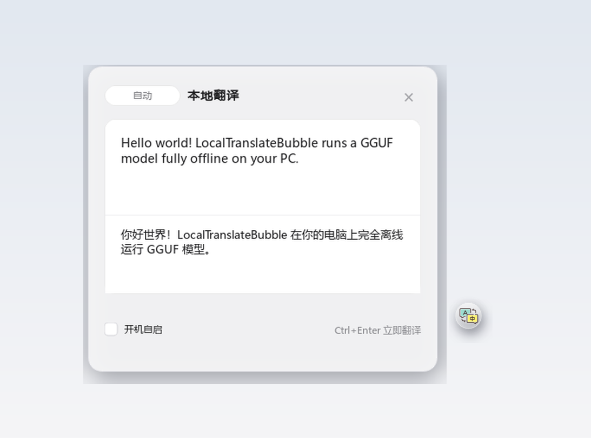

<div align="center">


# 本地翻译悬浮球 (translation_bubble)

**Windows offline floating translator: chat-bubble widget + macOS-light panel + local GGUF model**

[](https://github.com/Shewishees/translation_bubble/actions/workflows/build.yml)
[](LICENSE)
[]()
[](https://github.com/ifocus9/PopTrans)

[简体中文](README.md) · [English](README_EN.md)

*Selection translation · Screenshot OCR · Streaming output · Auto GPU acceleration · Fully offline*



</div>

---

**LocalTranslateBubble** is a fully offline translator for Windows: a chat-bubble widget breathes on
your desktop, translate selected text or a screenshot with one keystroke, and watch the translation
**stream in character by character** in a macOS-light panel. The inference engine is ported from
[PopTrans](https://github.com/ifocus9/PopTrans)'s Python AI engine: `llama.cpp` runs Tencent's
**Hy-MT2-1.8B** GGUF model locally, and **RapidOCR** handles screenshot text recognition —
no cloud, no telemetry, your text never leaves the machine.

## ✨ Features

- **🌀 Floating bubble widget**: breathing at 120 FPS with sub-pixel rendering; flies smoothly to your cursor after a capture, click to expand the panel.
- **✍️ Selection quick-translate** (default `Ctrl+Alt+Q`): select text anywhere, press the hotkey — the tool simulates `Ctrl+C` to capture it.
- **📷 Screenshot OCR translation** (default `Ctrl+Alt+E`): drag a region on a screen snapshot → RapidOCR → instant translation.
- **⚡ Streaming output**: OpenAI-compatible `/v1/chat/completions` (SSE); 256-entry LRU cache returns repeated text instantly.
- **🎮 Auto GPU acceleration with safe fallback**: `acceleration_device = auto/gpu/cpu`; full offload via CUDA/Vulkan (3–5× faster on an RTX 5070), automatic fallback to CPU on any failure.
- **🛌 AI idle recycling**: the engine sleeps after 15 idle minutes to free VRAM, and wakes automatically on the next translation.
- **⚙️ settings.json hot reload**: field-compatible with PopTrans; edits apply instantly without restarting.

## 🚀 Getting started

1. Download `LocalTranslateBubble-vX.Y.Z-windows-x64.zip` from [Releases](https://github.com/Shewishees/translation_bubble/releases) and extract it;
2. Run `LocalTranslateBubble.exe` — on first start the translation model (~1.1 GB) downloads automatically (resumable), or drop it into `models/Hy-MT2-1.8B-GGUF/` yourself;
3. When the panel shows **GPU acceleration ready / CPU mode ready**, you're translating offline.

> 💡 Requirements: Windows 10/11 x64; 8 GB RAM for CPU mode; ≥ 2 GB VRAM for GPU offload.

## ⌨️ Shortcuts

| Action | Shortcut | Notes |
| --- | --- | --- |
| Open the panel | Click the bubble | Bubble docks 16 px to the panel's right |
| Selection translate | `Ctrl+Alt+Q` | Bubble flies to the cursor, click it to read the result |
| Screenshot OCR | `Ctrl+Alt+E` | Drag a region, `Esc` to cancel |
| Translate now | `Ctrl+Enter` | Skips the 600 ms debounce |
| Switch direction | Pill next to the title | Auto (zh↔en) → zh→en → en→zh |
| Quit | Right-click the bubble | Open panel / capture / screenshot / quit |

## 💻 Run from source

```bat
python -m pip install -r requirements.txt
python bootstrap_backend.py      :: first run: install deps, prompt model download
start.bat                        :: launch (missing models are auto-downloaded)
```

Development dependency: Python 3.12+ recommended; for GPU acceleration install the matching
`llama-cpp-python` build (see build variants below).

## 📦 Building a release / CI

Build a portable release (bundled Python runtime, outputs `dist\`):

```bat
scripts\setup_build_env.bat      :: create a clean build venv (auto GPU/CPU detection)
scripts\build_all.bat            :: produce dist\LocalTranslateBubble.exe + ai_engine.exe
scripts\package_zip.bat 1.0.0    :: pack a release ZIP (1.1 GB model excluded by default)
```

**GitHub Actions**: pushing a `v*` tag builds everything on `windows-latest`, packs the ZIP and
attaches it to the matching Release (see [`.github/workflows/build.yml`](.github/workflows/build.yml)).

| Artifact | Notes |
| --- | --- |
| `dist\LocalTranslateBubble.exe` | PySide6 floating-bubble UI (onedir) |
| `dist\ai_engine.exe` | Single-file AI engine (FastAPI + llama.cpp + RapidOCR; CUDA runtime bundled) |
| `dist\models\rapidocr\` | OCR ONNX models |

Build variants: the GPU build is produced automatically on machines with NVIDIA drivers; run the
same scripts on a machine without `nvidia-smi` to get the universal CPU build.

## ⚙️ Configuration (settings.json, hot-reloaded on save)

| Field | Default | Description |
| --- | --- | --- |
| `hotkey` / `hotkey_display` | `<ctrl>+<alt>+q` / `Ctrl+Alt+Q` | Selection-translate hotkey |
| `ocr_enabled` / `ocr_hotkey` / `ocr_hotkey_display` | `true` / `<ctrl>+<alt>+e` / `Ctrl+Alt+E` | Screenshot OCR translation |
| `server_port` | `8989` | Local engine port (1024–65535; changing it restarts the engine) |
| `acceleration_device` | `auto` | Inference device: auto / gpu / cpu |
| `ai_idle_minutes` | `15` | Idle minutes before the engine sleeps (0 = never) |
| `launch_at_login` | `false` | Launch at login (HKCU Run key, synced with the panel checkbox) |
| `logging_enabled` | `false` | Write engine logs to `translate.log` |

## 🔌 Local HTTP API (PopTrans-compatible)

| Method | Path | Description |
| --- | --- | --- |
| `GET` | `/health` | Model readiness and hardware info (`device_info`) |
| `POST` | `/v1/chat/completions` | OpenAI-compatible translation (`stream=true` for SSE) |
| `POST` | `/api/v1/ocr` | RapidOCR image recognition (multipart) |
| `POST` | `/api/v1/ocr_translate` | OCR + translation in one call |

## 📄 License & credits

- Released under the **MIT License** (see [LICENSE](LICENSE)).
- The AI engine and interaction design are ported from [PopTrans](https://github.com/ifocus9/PopTrans) (MIT) — many thanks to the original author; the PySide6 floating-bubble shell and interactions are an independent implementation.
- Model: Tencent [Hy-MT2-1.8B-GGUF](https://huggingface.co/tencent/Hy-MT2-1.8B-GGUF) (official license applies), RapidOCR (Apache-2.0).

<div align="center"><sub>If this project helps you, a ⭐ would be appreciated.</sub></div>
